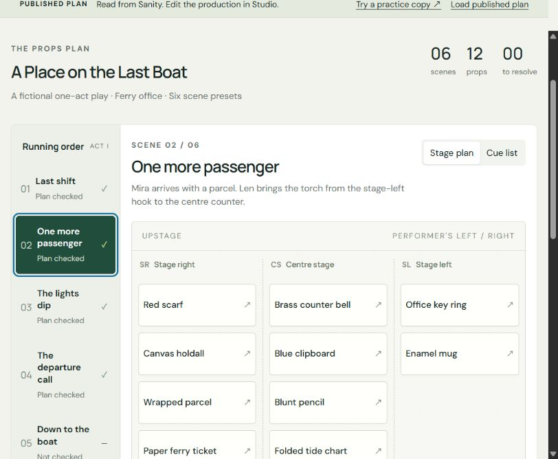
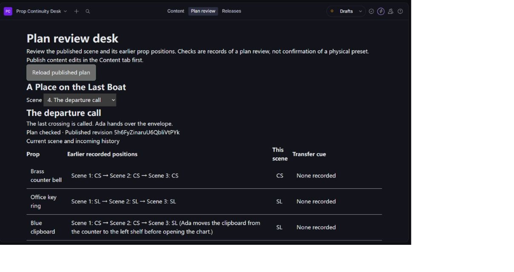

# Prop Continuity Desk

A rehearsal planning tool for a fictional six-scene play. Next.js renders a stage-zone board, detects duplicate physical props and missing scene-to-scene transfer cues, and expires checks when relevant content changes. Sanity stores productions, prop inventory, ordered scene presets and independent review records.

## Status

The app is connected to the owner's real Sanity project `x06ajbeo`, public dataset `production`. Nineteen fictional documents were imported; authenticated Studio edits, publication, persistent review records, draft isolation, concurrent-review rejection and downstream review invalidation were verified on 26 September 2026. Studio is deployed at https://prop-continuity-x06ajbeo.sanity.studio/ and requires an authorized Sanity login to edit.

**Live demo:** https://prop-continuity-desk.ogisosetsuna.chatgpt.site/

The rehearsal board is publicly accessible. Choose **Try a practice copy** to explore edits without changing the published production. Editing the real production requires an authorized Sanity Studio account; no shared administrator credentials are provided.





## Run

Use Node.js 22.12 or newer (tested with 24.19).

```sh
npm ci
npm run dev
npm test
npm run typecheck
npm run build
```

The web app uses Next.js static export in `out/`. All public configuration is embedded at build time. No browser write token is used. `sanity.config.ts` is a separate authenticated Studio and is not included in the public web export.

## Connect the owner's free Sanity project

1. The owner signs in to Sanity and creates a project with a **public** dataset named `production`. All seed content is fictional. Keep the permanent Free plan; no card or paid runtime is needed.
2. Copy `.env.example` to `.env.local` and set the real project ID in both `NEXT_PUBLIC_SANITY_PROJECT_ID` and `SANITY_STUDIO_PROJECT_ID`. Set the dataset and production ID consistently. Keep credentials out of public variables and Git. The Studio CLI may load `.env` rather than `.env.local` depending on its execution environment; export `SANITY_STUDIO_*` variables explicitly if needed.
3. Run `node --experimental-strip-types scripts/create-seed.ts`. This writes 19 documents and no invented approvals. After the owner logs in through the installed local CLI with `npm exec -- sanity login`, import into a dedicated project with `npm exec -- sanity datasets import seed.ndjson --dataset production --project-id YOUR_PROJECT_ID --missing`. This import has already been completed for `x06ajbeo`; do not reset its published edits or review records.
4. Start Studio with `npm run studio`. Content editing happens in the Content tab. Publish the production, its twelve props and its six scenes. The Plan review tab shows the published snapshot and its relevant history; it rejects a changed snapshot before saving a check.
5. Configure Sanity CORS for the exact web origin with credentials disabled, and for the trusted Studio origin with credentials enabled. The local web origin and current Sites origin have been added without credentials. Rebuild the public app after changing configuration; verify actual browser reads before claiming a working web integration.
6. Studio has been deployed on Sanity's free hosting after the owner authorized login. Its URL and the public project ID are in `.env.example`; credentials are not. The `deployment.appId` identifies this owner's hosted Studio and must be changed when deploying a separate fork. The `.openai/hosting.json` project ID likewise belongs to this owner's Sites deployment; configure your own hosting target for a fork. Verify judge access to the public view before entering: a private Sites preview is not a public contest demo.

## Demonstrate the workflow

The bundled sample begins in scene 2 with a torch missing its incoming cue and a parcel listed in two locations. The connected published dataset already contains the verified repair: parcel at stage right, with the torch's incoming cue supplied. Review records are real validation actions, not seeded approvals. In a practice copy, change a relevant earlier cue and observe a later check requiring review. Exported cue sheets preserve whether they came from a practice copy.

Practice edits and checks stay in the current tab; reloading resets them. Published data loads only after a successful Sanity fetch. A failed request is shown visibly. A request sequence prevents a late response from replacing a newer selection or reset.

## What a check means

- A scene is a planned position snapshot, not a continuous physical tracking system. Stage left/right are the performer's directions; the plan places the audience below the stage.
- A first appearance is a preset. Omission never silently means backstage. Later appearances compare with the last recorded position, including across omitted scenes.
- Cues are checked for nonempty text. Their theatrical plausibility and the actual move need human judgment.
- The change token includes current scene revision, content, relevant prop definitions and prior recorded placements/cues. Future scenes and unrelated prop changes do not invalidate a check. Reordering placement rows is harmless.
- Reviews are separate documents, so saving one does not change the scene's own Sanity revision. A post-check concurrent change leaves a historical record that fails the new fingerprint comparison. GROQ is eventually consistent; the public screen is a snapshot, not a real-time lock.
- The Free plan has Administrator/Viewer roles. Read-only Studio controls are UI safeguards, not tamper-proof authorization. This demo assumes a trusted production team.
- Only generic `Production editor` attribution is placed in public review records. No personal email, account secret or private conversation is seeded or required.

## Validation and provenance

Domain tests cover duplicate props, missing cues across gaps, dependency edits, unrelated changes, malformed references and stale-review refresh. Integration tests evaluate the actual GROQ projection locally, validate the six-scene/twelve-prop story and reject incomplete data. Earlier sample-browser checks covered repair, review, downstream invalidation, export controls, mobile width and WebMCP inputs. Separately, the real Studio validation confirmed login, reads, draft/publish separation, review persistence, rejection of an outdated displayed plan, and invalidation/rechecking of scene 6 after a scene 2 edit. A stale success message found during scene switching was fixed and verified. These findings do not establish contest submission, prize eligibility beyond the owner's declaration, or payment.

The deployed frontend was separately verified reading the real published dataset. A practice cue change expired affected checks locally; loading the published plan restored the unchanged server data. A real downloaded cue sheet preserved its PRACTICE COPY label.

The fictional story and application were created for this project with Codex on 26 September 2026. The build account must state that accurately; no claim is made that the owner manually authored or tested the code. Open-source dependencies retain their respective licenses. Fonts: DM Sans and Manrope via Google Fonts. No competitor source or production data was used.

Official references: [Sanity Challenge](https://dev.to/challenges/sanity-2026-09-16), [Sanity transactions](https://www.sanity.io/docs/content-lake/transactions), [Studio hooks](https://www.sanity.io/docs/studio/studio-react-hooks), [Sanity Free plan](https://www.sanity.io/pricing).
